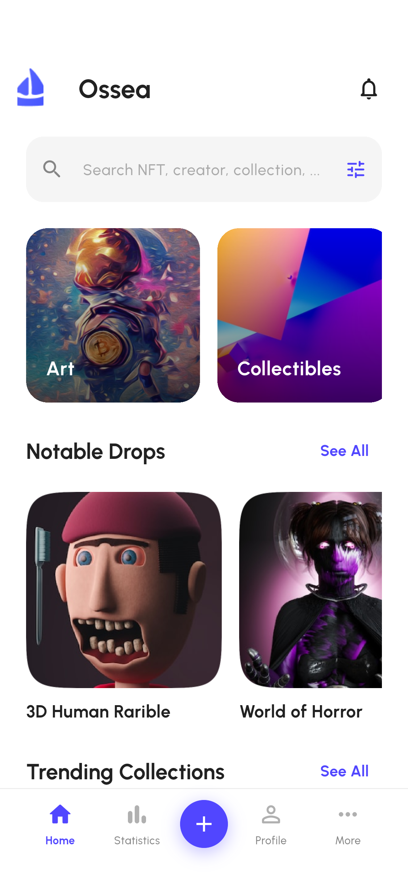
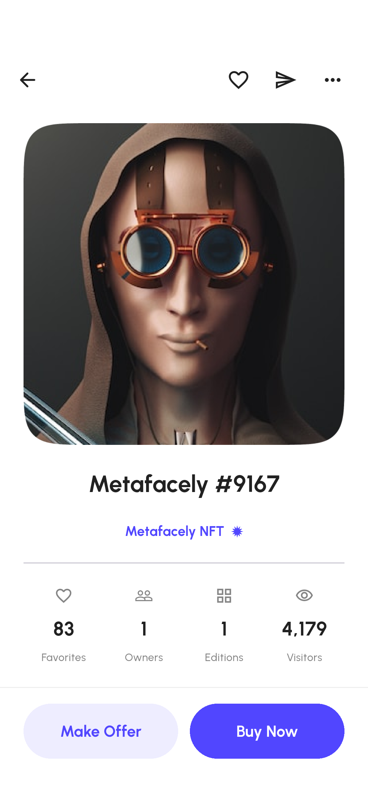
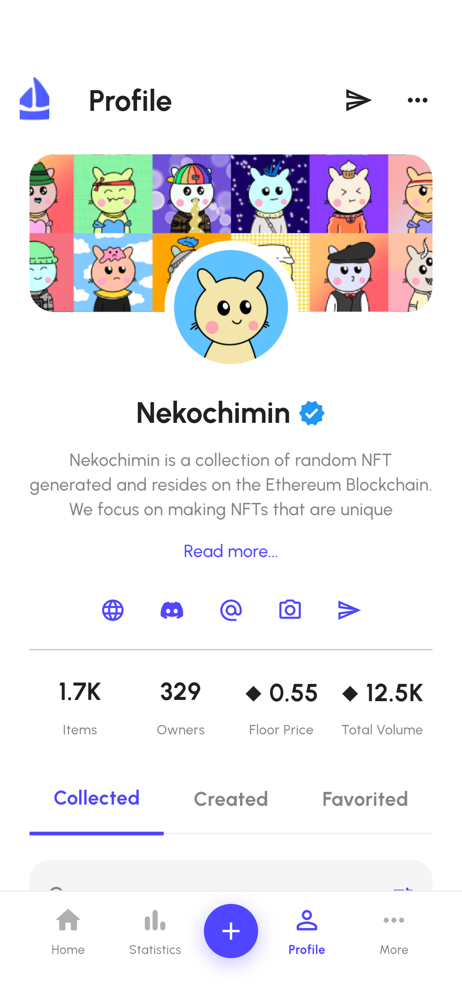
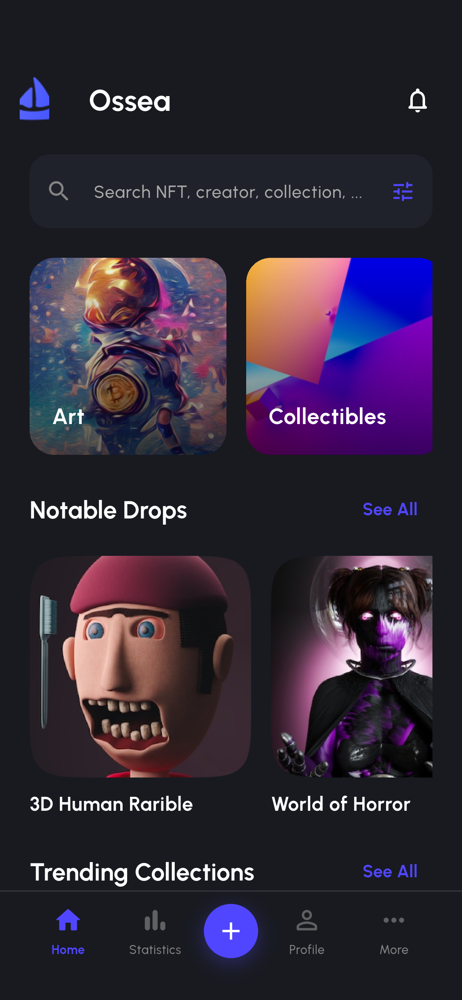
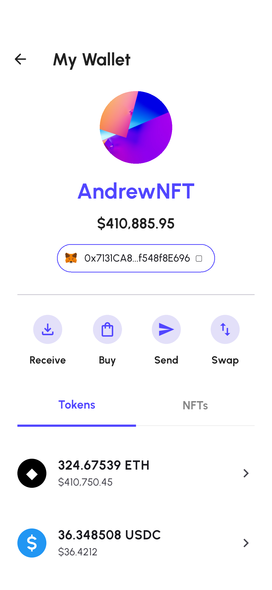
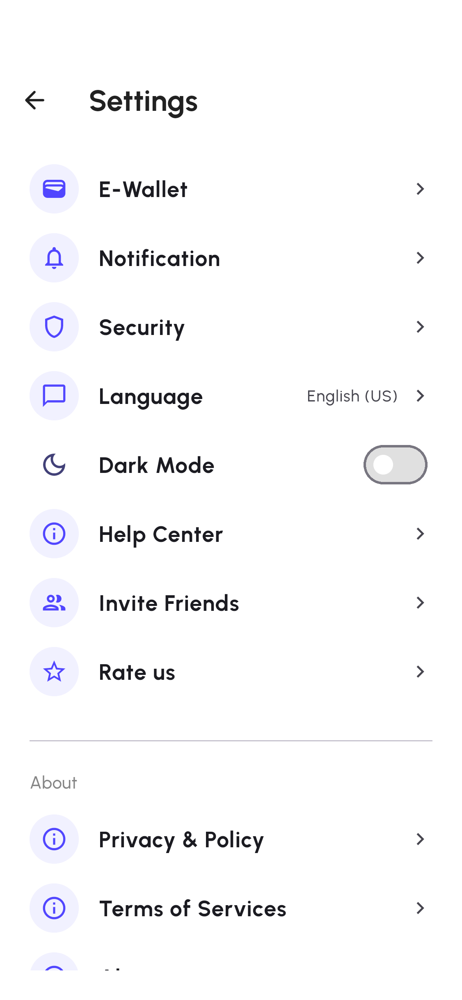
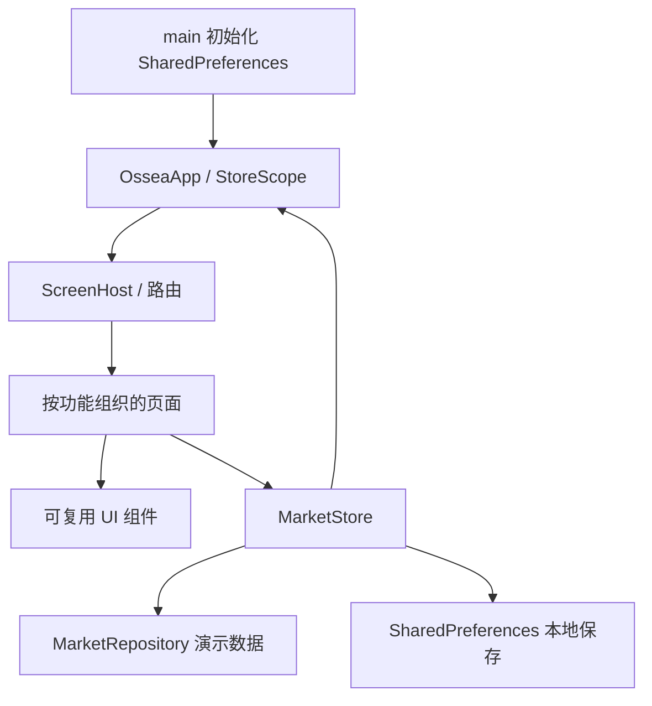

# Ossea · NFT Marketplace

基于 Pixso「Ossea - NFT Marketplace App UI Kit」开发的 Flutter NFT 市场应用。沿用设计稿的 Urbanist 字体、蓝紫色主题、圆角卡片与原始图片，支持浅色 / 深色主题。

## 界面预览

以下图片来自应用实际运行截图。完整截图可在 [截图目录](docs/screenshots/) 和 [截图浏览器](docs/screenshots/index.html) 中查看。

| 首页 | NFT 详情 | 个人资料 |
| --- | --- | --- |
|  |  |  |

| 深色首页 | 钱包 | 设置 |
| --- | --- | --- |
|  |  |  |

## 设计分类与实现范围

已读取 Pixso 的全部四个分类：

| 分类 | 内容 | 处理方式 |
| --- | --- | --- |
| 🔆 Light Theme | 81 个画板 | 对应 81 个可访问页面 / 状态入口 |
| 🌙 Dark Theme | 81 个画板 | 复用页面，由统一主题切换 |
| 🎨 Design System | Colors、Typography、Iconography、Components & Variants、Elements、My Profile | 提取字体、颜色、间距与组件模式 |
| 👀 Preview | 原稿展示分类 | 作为预览用途，不作为额外业务页面 |

画板包括同一页面的完整长页、适配首屏、筛选弹窗、成功弹窗和空状态，并不代表 162 个互不相关的业务页面。完整页与适配页复用同一可滚动界面，具体对应关系见 [81 个画板对照表](docs/UI_COVERAGE.md)。

## 已实现功能

- 三步引导、访客浏览、钱包演示连接与公开 ETH 地址校验。
- 首页、分类、推荐、收藏集列表，搜索与空结果状态，分类 / 链 / 价格筛选和排序。
- 排名与活动列表、展开详情、筛选面板。
- 创作者主页、NFT 详情、属性、报价 / 上架 / 活动列表和价格走势图。
- 报价 → 币种授权 → 签名 → 成功，以及购买 → 签名 → 成功的本地演示流程。
- NFT 创建、图片选择、表单校验、属性添加、上架和收藏集创建。
- 个人资料标签、收藏、已创建、报价记录、已购买、关注列表。
- 钱包资产展示、地址复制、设置、主题切换、通知偏好、语言偏好、帮助中心与模拟邀请。
- 本地保存主题、连接状态、收藏、关注、购买、报价、创建内容及上架状态。

**数据范围：** 本项目是可交互 UI 演示，未接入后端、真实钱包签名或区块链。购买、授权、上架、邀请均为本地模拟；收发和兑换入口说明其演示范围。语言和安全开关保存偏好，未接入多语言翻译、系统生物认证或 Google Authenticator。上传支持 PNG / JPG / WEBP，演示限制为 2 MB；原稿中的音视频与 3D 文件上传未接入。

## 项目结构

```text
lib/
├── main.dart                       # 初始化本地存储与应用
├── app.dart                        # 主题、导航与依赖注入
├── core/
│   └── theme.dart                  # 颜色、字体、表单及按钮规范
├── data/
│   └── market_repository.dart      # 模型、演示商品、收藏集与排行榜数据
├── state/
│   └── market_store.dart           # 状态修改、派生资产与本地持久化
├── navigation/
│   └── screen_catalog.dart         # 81 个画板编号与名称
├── widgets/
│   └── ui.dart                     # 图片、卡片、搜索、标签、按钮等公共组件
└── features/
    ├── screen_host.dart            # 页面装配、顶部栏、底部导航和弹窗
    ├── onboarding/                 # 引导与钱包登录
    ├── market/                     # 首页、浏览、搜索、筛选、通知
    ├── statistics/                 # 排名、活动和筛选
    ├── nft/                        # 详情、交易、创建、上架
    ├── profile/                    # 个人资料与创作者主页
    └── account/                    # 更多、钱包、收藏集和设置
assets/
├── fonts/                          # Urbanist 字体与 OFL 许可证
└── images/                         # 从 Pixso 提取的独立图片素材
android/                            # Android 工程
ios/                            # iOS 工程
web/                                # Flutter Web 工程
integration_test/                   # Android 全画板截图测试
test_driver/                       # 截图文件写入驱动
test/                              # 状态、持久化、布局和流程测试
tool/                              # 长页截图与文档截图目录生成工具
docs/
├── ARCHITECTURE.md                 # 架构与维护说明
├── UI_COVERAGE.md                  # 画板、路由、源码、截图对应表
├── VERIFICATION.md                 # 验证方式和结果
├── design/                         # Pixso 原稿记录与参考图
└── screenshots/                    # 实际运行截图、长页图和浏览索引
```

## 架构



使用 Flutter 内置的 `ChangeNotifier` 与 `InheritedNotifier` 管理状态，按业务模块组织界面，避免给 UI 项目增加多余的框架层。详情、交易、创建表单均接收商品参数，公共状态集中修改。后续接入 API 或链上服务时，可从数据与状态层替换演示实现，详情见 [架构说明](docs/ARCHITECTURE.md)。

## 运行

开发环境：Flutter 3.47.7 / Dart 3.13.5。

```sh
flutter pub get
flutter run -d emulator-5554
```

也可运行 `flutter run -d chrome`。iOS 工程已生成，需在 macOS / Xcode 上编译验证。

首次启动进入引导；可选访客浏览，或选择任意钱包进行演示连接。主导航为 Home、Statistics、创建、Profile、More。

逐页查看入口：**More → Explore All Screens**，共 81 项；在 **Settings → Dark Mode** 切换主题。

```sh
flutter analyze
flutter test
flutter build apk --release
```

生成模拟器截图：

```sh
flutter drive --driver=test_driver/screenshots.dart --target=integration_test/screenshots_test.dart -d emulator-5554
```

生成完整滚动内容长图与截图索引：

```sh
flutter testtool/capture_long_screenshots.dart
pythontool/build_docs.py
```

Android APK 输出位置：`build/app/outputs/flutter-apk/`。可交付安装包另存于 `dist/`。交付包使用本地调试签名，正式发布需配置发布签名。

- [Android ARM64 安装包（多数手机）](dist/Ossea-1.0.0-arm64-v8a.apk)
- [Android ARMv7 安装包](dist/Ossea-1.0.0-armeabi-v7a.apk)
- [Android x86_64 安装包（模拟器）](dist/Ossea-1.0.0-x86_64.apk)
- [验证记录](docs/VERIFICATION.md)

## 设计来源与素材

Pixso 文档：**Ossea - NFT Marketplace App UI Kit**。原始页分类和画板编号保存在 `docs/design/light.json`、`dark.json`、`system.json`、`preview.json`；素材与节点对应关系见 `docs/design/asset-sources.json`。原稿参考图和运行截图分别保存在 `docs/design/` 与 `docs/screenshots/`。

Urbanist 字体随附 OFL 开源许可证。设计稿插画与 NFT 图片来自用户提供的参考，生产发布前应使用有对应授权的素材。

