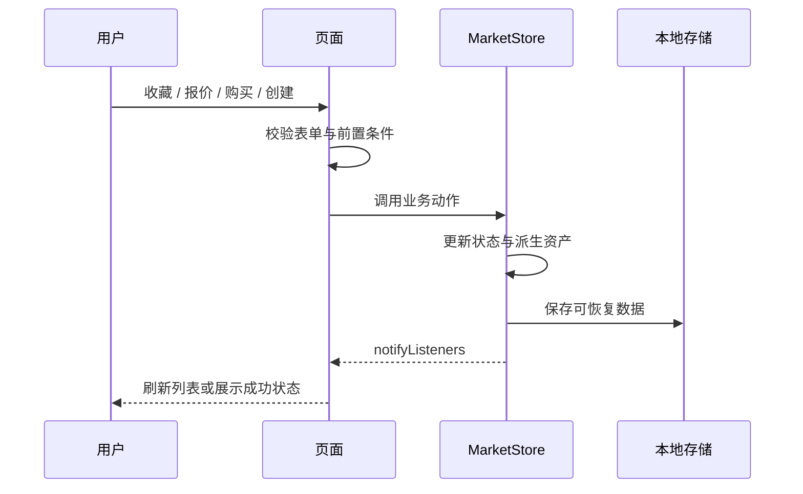

# 项目架构与维护说明

## 设计依据

项目读取了 Pixso 文件 `Ossea - NFT Marketplace App UI Kit` 的四个页面分类。Light Theme 与 Dark Theme 各含编号 1–81 的画板；Design System 提供六组规范；Preview 提供展示用的预览板。

参考基准宽度为 428，常规画板高度为 926。应用使用 Flutter 逻辑像素，24 的横向留白、16–24 的卡片圆角、56 的主要按钮高度、Urbanist 字体和 `#5146FF` 主色。深色画布为 `#181A20`，输入区域为 `#1F222A`。素材通过 Pixso 节点导出，图片不是整页贴图，文字、按钮、列表和表单均为 Flutter 组件。

完整页面和适配页面是同一内容的不同展示方式，应用将其合并为可滚动页面；81 个编号入口仍保留，便于与原稿对应。系统图标使用 Material Icons，部分图标、系统状态栏和底部系统导航的表现随平台不同。

## 模块职责

| 模块 | 责任 | 主要文件 |
| --- | --- | --- |
| 启动与应用装配 | 初始化存储、绑定主题、构建导航 | `lib/main.dart`、`lib/app.dart` |
| 视觉规范 | 全局颜色、字体、按钮、表单及开关 | `lib/core/theme.dart` |
| 数据模型与演示数据 | 收藏集、NFT、分类及排名数据 | `lib/data/market_repository.dart` |
| 状态与持久化 | 收藏、关注、购买、报价、创建及设置 | `lib/state/market_store.dart` |
| 页面目录 | 原稿 1–81 编号及名称 | `lib/navigation/screen_catalog.dart` |
| 页面容器 | 编号分发、参数传递、导航栏、弹窗 | `lib/features/screen_host.dart` |
| 公共组件 | 图片、卡片、网格、搜索框、选择标签及底部操作栏 | `lib/widgets/ui.dart` |
| 业务界面 | 按引导、市场、统计、NFT、个人资料、账户组织 | `lib/features/*/` |

这里采用按功能划分的轻量分层结构。页面读取 `MarketStore`、调用业务动作；状态集中保存；演示数据集中定义。没有为静态 UI 增加多余的服务、用例和仓库接口。

## 状态流转

`StoreScope` 基于 `InheritedNotifier`，向页面提供同一个 `MarketStore`。主题切换由 `OsseaApp` 监听并重建 `MaterialApp` 的主题模式，不复制深色页面。图片和主题都为本地资源，主要演示流程可以离线使用。

## 导航与画板状态

统一使用 `/screen/<编号>` 命名路由。`ScreenHost` 根据编号装配对应业务组件，并通过 `arguments` 接收 `NftItem`、`CollectionItem` 或 `TradeRequest`。

| 编号范围 | 业务模块 |
| --- | --- |
| 1–5 | 启动、引导、钱包登录 |
| 6–23 | 市场首页、分类、搜索、筛选、通知 |
| 24–31 | 排名、活动、统计筛选 |
| 32–40 | 创作者主页和 NFT 详情 |
| 41–48 | 报价、授权、签名、购买、成功提示 |
| 49–57 | 创建 NFT、上架和已上架详情 |
| 58–65 | 个人资料各标签、分享和更多操作 |
| 66–73 | 更多、钱包、收藏集、创建收藏集和关注 |
| 74–81 | 设置、偏好、帮助、模拟邀请和退出 |

成功弹窗、分享、退出和统计筛选会在对应页面进入后显示。普通用户从业务入口触发这些流程；页面库允许直接访问参考状态。成功状态的直接预览不会自动创建订单或改变资产。

## 数据模型

`NftItem` 保存编号、名称、所属收藏集、图片标识和价格。`CollectionItem` 保存名称、封面、头像、分类、链、出售状态与底价。`TradeRequest` 将 NFT 和报价金额一起传到后续交易页面，避免各页面重复读取静态商品。

`MarketStore` 保存以下信息：

| 状态 | 用途 | 重启后恢复 |
| --- | --- | --- |
| `dark`、`language`、`settings` | 主题、语言选择、通知和安全偏好 | 是 |
| `connected`、`walletProvider`、`onboarded` | 演示连接与引导状态 | 是 |
| `favorites`、`watchlist` | 收藏 NFT 和关注收藏集 | 是 |
| `purchased`、`offers`、`listed` | 本地购买、报价、上架记录 | 是 |
| `created`、`createdCollections` | 创建的 NFT 与收藏集 | 是 |
| 搜索词、筛选、表单草稿、帮助展开、邀请按钮 | 页面临时交互 | 否 |

偏好使用 `SharedPreferences` 保存。复杂记录转为 JSON；演示上传图片以数据 URI 保存，限制 2 MB。正式产品应将文件保存到文件系统或对象存储，数据库只保存文件标识。

钱包余额从本地已购商品价格派生，同一 NFT 重复购买不会再次扣减；购买记录、个人资产和钱包 NFT 列表使用同一状态来源。演示数据中没有真实密钥、签名材料或后端凭据。

## 主要流程

1. **报价**：校验正数金额与余额 → 授权预览 → 确认签名 → 保存报价 → 成功弹窗 → Offers Made。
2. **购买**：接收商品参数 → 可选收货地址校验 → 确认签名 → 保存已购 ID → 成功弹窗 → Purchased。
3. **创建 NFT**：选取本地图片或示例 → 填写名称、描述、收藏集、供应量等 → 校验 → 保存创建记录 → 未上架详情。
4. **上架**：选择价格类型、价格和期限 → 确认签名 → 保存上架标记 → 已上架详情。
5. **创建收藏集**：设置 Logo、封面和横幅 → 名称及链接校验 → 保存 → My Collections。

创建页中的属性、级别、内容开关等支持 UI 操作，但不构建真实链上元数据；上架期限、预留买家等为演示表单，不执行链上约束。

## 可复用组件与精简策略

- `Art` 统一处理本地素材、上传图片、圆角和加载失败显示。
- `CollectionCard/Grid` 与 `NftGrid` 统一商品列表样式。
- `ChoiceTabs`、`CategoryChips`、`SearchBox` 与 `SelectionRow` 统一输入和选择。
- `BottomActions` 与 `PrimaryButton` 统一底部固定操作。
- `ProfilePage` 同时承载创作者和个人资料；`CheckoutPage` 复用授权与签名布局。
- `CreatePage` 复用 NFT 与收藏集的上传和表单字段。
- 深浅主题共用业务组件；完整页与首屏共用滚动内容。
- 保留设计证据、测试和截图工具；移除默认计数器示例与无用素材。

## 后续接入位置

接入真实服务时，将 `MarketRepository` 的演示集合替换为 API 数据来源，并在状态层处理加载、分页、失败与重试；将报价、购买、创建和上架的本地写入替换为服务调用，接入钱包连接和签名，并在交易确认后刷新资产。安全开关、翻译和分享平台需要相应的系统能力或 SDK。

正式产品还需使用数据库保存业务记录、文件存储保存上传内容，并完善时间 / 币种 / 数值格式与多语言资源。此交付重点是按参考实现 Flutter UI、可操作的演示流程、工程结构与截图文档。

## 截图和验证

- `docs/screenshots/light/01.png` 至 `81.png`：Android 模拟器浅色截图。
- `docs/screenshots/dark/01.png` 至 `81.png`：Android 模拟器深色截图。
- `docs/screenshots/long/`：使用生产组件渲染完整滚动内容的长图，宽度为 856 像素；不是设计稿导出图。
- `docs/design/`：Pixso 原稿截图、分类节点与图片素材来源，和运行结果分开保存。
- `docs/screenshots/index.html`：可按主题和页面名称浏览截图的本地索引。

测试记录与复现命令见 [验证说明](VERIFICATION.md)，逐画板对应关系见 [UI 对照表](UI_COVERAGE.md)。
